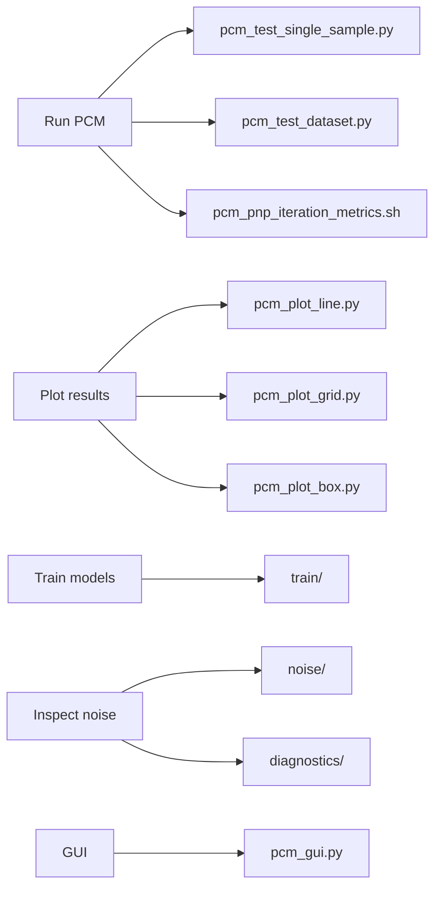

# PCM scripts

Small entry points for running, plotting, training, debugging, and viewing photocurrent mapping experiments.



## What should I run?

| Goal | Entry point |
| --- | --- |
| Run one sample | `pcm_test_single_sample.py` |
| Run a dataset | `pcm_test_dataset.py` |
| Compare PnP iteration metrics, methods, noise realizations, and snapshots | `pcm_pnp_iteration_metrics.sh` |
| Open the PCM GUI | `pcm_gui.py` |
| Plot a metric against sampling rate | `pcm_plot_line.py` |
| Plot a sampling/coarse-J grid | `pcm_plot_grid.py` |
| Plot method-comparison box plots | `pcm_plot_box.py` |
| Re-render a saved lambda map | `pcm_render_lambda.py` |
| Train/test PCM SAPM models | `train/` |
| Inspect the PCM noise model | `noise/`, `diagnostics/` |
| Inspect saved results | `results/` |

## Common commands

Run the E27 average-map preset:

```bash
python scripts/pcm/pcm_test_single_sample.py \
    --preset e27_pos1_average_map_simulated_noise
```

Run the CIA PnP iteration comparison:

```bash
bash scripts/pcm/pcm_pnp_iteration_metrics.sh
```

The CIA script selects the methods, noise realizations, snapshot iterations,
and plot layouts explicitly in the shell file. The current example compares
`pnp_admm_drunet` and `pnp_admm_dwtdnet_tiny` at 20% sampling and coarse J = 8.

The no-noise and noisy scenarios use the same Hadamard sampling pattern.
Different noise realizations also keep that sampling pattern fixed and vary
only the simulated noise.

The script can save:

- one figure for each method/scenario pair;
- methods overlaid within each noise scenario;
- noise scenarios overlaid for each method.

Selected snapshot iterations, the best reconstruction according to a chosen metric,
and the last reconstruction can be shown as images in the same figure. The selected
points are marked on PSNR, SSIM, HaarPSI, and MSE curves. Figures can use either
iteration number or cumulative reconstruction time on the x-axis.

## Folder guide

- `train/`: current PCM training and checkpoint-testing scripts.
- `noise/`: examples and notebooks for PCM noise simulation.
- `diagnostics/`: focused diagnostic experiments.
- `results/`: small scripts for inspecting and plotting saved results.

The top level currently also contains historical experiment launchers.
They are left in place for now so old commands and notes are not broken.

<details>
<summary><strong>Legacy or uncertain launchers</strong></summary>

The following shell scripts still reference the old
`scripts/pcm/photocurrent_mapping.py` entry point, which is not present in
this folder snapshot. They may still document useful old experiments, so
they have not been deleted.

- `full_test_no_noise_ap100us.sh`
- `full_test_no_noise_cigs_scale.sh`
- `full_test_no_noise_default.sh`
- `full_test_noise_ap100us.sh`
- `full_test_noise_ap100us_new_fidelity.sh`
- `full_test_noise_ap100us_spgl1.sh`
- `full_test_noise_default.sh`
- `full_test_noise_default_cigs.sh`
- `full_test_silicon_1_image.sh`
- `full_test_silicon_1_measurement_real_noise.sh`
- `quick_test_debug.sh`
- `quick_test_gaussian.sh`
- `quick_test_pcm_noise_scale.sh`

Other files worth checking later:

- `train/zs.sh` calls `scripts/pcm/pcm_self_supervised_sapm_train.py`, while the
  Python file currently lives under `scripts/pcm/train/`.
- `supervised_gs_drunet_train.py` describes Cartesian MRI training, so it may
  not belong in the PCM scripts folder.
- `poc.py` appears to be an older GUI proof of concept. `pcm_gui.py` is the
  current small GUI entry point.

</details>

## Naming rule for new scripts

For new scripts, prefer:

```text
pcm_<task>.py
pcm_<task>.sh
```

If a shell script only launches one Python entry point, keep the same stem
where practical. Existing historical files are not renamed yet because
other notes or commands may still refer to their current names.

## Cleanup approach

Do not delete uncertain scripts just because they look old.

A safer sequence is:

1. Mark clearly stale files in this README.
2. Confirm whether anything still calls them.
3. Move confirmed historical scripts to a `legacy/` folder.
4. Delete only after the historical scripts have clearly become unnecessary.

This keeps cleanup gradual and reversible.
